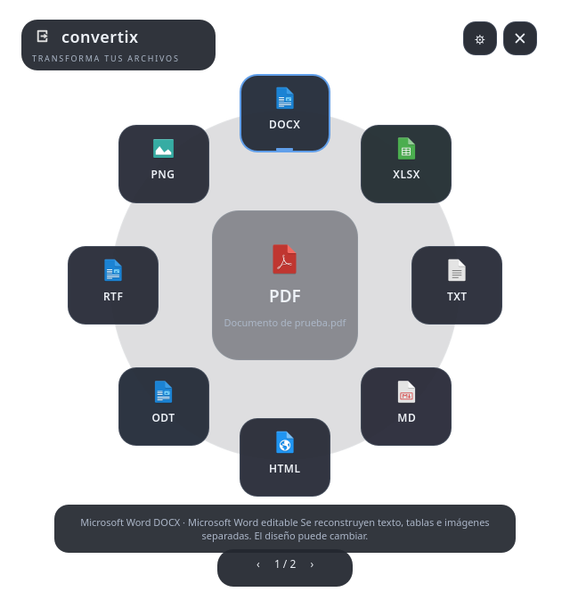

# Convertix 2.0

Conversor de escritorio local para Fedora KDE Plasma 6. Menú radial en Qt Quick,
motores reales, originales intactos y resultados junto al archivo seleccionado.
Incluye PDF → Word editable, OCR local español/inglés, extracción de tablas y reconstrucción de documentos.
No usa servicios externos, IA en la nube, cuentas, telemetría ni descargas durante el uso.



**Estado:** ampliación de la aplicación existente. Las conversiones y la interfaz
se prueban con archivos sintéticos; consulta [la verificación](docs/VERIFICATION.md) para los resultados
y los pasos de aceptación todavía pendientes. El clic contextual completo desde Dolphin no se da por probado.

## Uso

En Dolphin selecciona uno o varios archivos locales, clic derecho → **Convertir…** y selecciona
un destino en el círculo. El resultado queda junto al original. Puedes abrirlo o mostrarlo en Dolphin.
La acción está marcada como de primer nivel; su visibilidad definitiva requiere la prueba manual descrita abajo.

- Flechas: recorrer opciones; Enter: convertir; Tab: recorrer controles; Escape: cerrar o cancelar antes de salir.
- Clic fuera: cierra el menú cuando está listo. Durante una conversión, usa Cancelar o cierra la ventana para cancelar.
- Engranaje: tema, animaciones, notificaciones, conflictos, calidad, resolución, exportación de hojas,
  **transparencia del fondo radial** (85 % por defecto) e **idiomas OCR** (`spa+eng` por defecto).
- La transparencia afecta al fondo decorativo. Las regiones fuera del círculo están vacías, los botones
  conservan cerca del 98 % de opacidad y sus iconos/textos permanecen opacos. 100 % oculta la decoración;
  0 % la hace sólida. El centro es translúcido. No se promete que los clics atraviesen hacia Dolphin:
  las regiones vacías son una zona explícita para cerrar el menú.
- Más de ocho destinos: páginas circulares con botones y PageUp/PageDown. No se superponen opciones.
- Al seleccionar un lote solo aparecen destinos comunes a todos sus archivos.

También aparece **Convertix** en el lanzador de aplicaciones, con un selector de archivos.
No depende de abrir una terminal ni del directorio de este proyecto.

```bash
~/.local/bin/convertix '/ruta/documento.docx'
~/.local/bin/convertix --list '/ruta/documento.docx'
~/.local/bin/convertix --to pdf -- '/ruta/documento.docx'
~/.local/bin/convertix --to pdf --timeout 600 -- '/ruta/documento grande.odt'
~/.local/bin/convertix --to docx -- '/ruta/documento.pdf'
~/.local/bin/convertix --to xlsx -- '/ruta/tablas.pdf'
~/.local/bin/convertix --to pdf-ocr -- '/ruta/escaneado.pdf'
~/.local/bin/convertix --diagnose
```

La notificación de KDE se emite desde la interfaz. La CLI informa por su salida y código de retorno
(0 correcto, 1 si hubo errores, 130 al interrumpir). Para rutas que comienzan por guion utiliza `--`.

## Formatos

Los destinos se calculan a partir del contenido y las dependencias disponibles. No se ofrece convertir
al mismo formato, salvo **PDF + OCR**, que añade una capa textual y siempre crea otro archivo.

| Orígenes | Destinos implementados |
|---|---|
| DOC, DOCX, ODT, RTF, TXT UTF-8, HTML, Markdown | PDF, DOCX, ODT, RTF, TXT, HTML, Markdown, DOC |
| XLS, XLSX, ODS, CSV UTF-8, TSV UTF-8 | PDF, XLSX, ODS, CSV, TSV, XLS |
| PPT, PPTX, ODP | PDF, PPTX, ODP, PPT |
| PNG, JPG/JPEG, WebP, BMP, TIFF, GIF | PNG, JPG, WebP, BMP, TIFF, GIF, PDF |
| PDF digital o con OCR existente | DOCX, TXT, MD, HTML, ODT, RTF, PNG, JPG; XLSX si se detectan tablas |
| PDF escaneado o mixto | OCR selectivo → DOCX, TXT, MD, HTML, ODT, RTF y PDF buscable; XLSX si hay una cuadrícula reconocible; PNG/JPG |

LibreOffice proporciona los filtros Office y Markdown. Pillow convierte imágenes y animaciones.
Poppler valida PDF y exporta imágenes/texto. **PyMuPDF** extrae texto, estilos, imágenes, enlaces y tablas;
**python-docx** genera Word editable y **openpyxl** genera libros Excel. **Tesseract** añade OCR donde hace falta.
Las rutas dependientes de OCR se ocultan si faltan el ejecutable o los idiomas seleccionados.
Un PDF sin contenido textual relevante ofrece imágenes, no un Word vacío ni una hoja de cálculo inventada.

## PDF editable y OCR

El análisis se realiza por página en un proceso separado, cancelable, con límites de tiempo/memoria y sin red.
Distingue páginas digitales, escaneadas, mixtas, con OCR previo y sin texto relevante. Una portada vacía
no convierte todo el documento en «escaneado». La clasificación usa texto extraíble, trazas de texto
invisible, cobertura de imágenes y contraste; es una heurística, no un clasificador perfecto de fotografías.
Una capa OCR previa se detecta por texto invisible o fuentes como GlyphLessFont, sin prometer medir su precisión.

PDF → DOCX crea párrafos, encabezados estimados por tamaño de fuente, tablas reales, imágenes separadas,
listas con sus marcadores, enlaces, formato básico, secciones/páginas y dos columnas cuando hay evidencia clara.
El resultado contiene texto editable: no es una colección de capturas. La reconstrucción puede cambiar el diseño,
las fuentes, la paginación y el orden de lectura en composiciones complejas. No se garantiza fidelidad exacta.

Para páginas escaneadas se renderiza una entrada OCR a 300 ppp y se invoca Tesseract solo en las páginas
marcadas. Se enmascara el texto digital ya existente en esa entrada para evitar duplicarlo. Se rechazan
resultados vacíos o de confianza muy baja. El PDF buscable conserva la página original y añade una capa
invisible de texto; las pruebas comparan también sus píxeles renderizados. Las rotaciones de página se respetan.
No se realiza deskew general ni orientación automática de escaneos torcidos sin metadatos.

Los idiomas se configuran como `spa`, `eng` o `spa+eng`. Diagnóstico muestra los idiomas realmente instalados.
La preferencia no instala nada automáticamente. PDF → TXT usa OCR selectivo cuando está disponible;
si no lo está, un PDF mixto puede ofrecer la extracción de su texto existente con una advertencia explícita.

PDF → XLSX usa tablas delimitadas por líneas detectadas por MuPDF. En escaneos se exige una cuadrícula
con líneas horizontales/verticales conectadas y datos OCR utilizables. Cada tabla ocupa una hoja `P1_Tabla1`,
`P1_Tabla2`, etc. Las tablas sin bordes, celdas fusionadas, giros complejos y estructuras ambiguas pueden no
detectarse o perder estructura. No se convierten párrafos en columnas arbitrarias. Los identificadores con
ceros iniciales se mantienen como texto y las cadenas que parecen fórmulas no se ejecutan como fórmulas.

Markdown y HTML incluyen encabezados, párrafos, listas, tablas, código, enlaces e imágenes separadas con rutas
relativas verificadas. PDF → ODT/RTF pasa por un DOCX intermedio validado y después por LibreOffice; un fallo
en cualquier etapa impide publicar. En escaneos las ilustraciones incluidas dentro de la imagen de la página
no se separan automáticamente. Los gráficos vectoriales complejos tampoco se reconstruyen como objetos editables.

## Integridad y limitaciones de conversión

- Nunca se modifica el original. Se copia desde un descriptor abierto con `O_NOFOLLOW`, se comprueba
  que no cambie durante la copia y solo se convierte esa copia. Los enlaces simbólicos finales se rechazan.
- Los nombres Unicode y los espacios funcionan. Si `informe.pdf` existe, se crea `informe (convertido 2).pdf`.
  La política alternativa detiene e informa. Ninguna política permite reemplazar documentos existentes.
- El trabajo se hace en un directorio privado `.convertix-*` en el mismo sistema de archivos del destino.
  Se valida la estructura de salida y se sincronizan los datos antes de publicar con `renameat2(RENAME_NOREPLACE)`.
  Si el disco no soporta esa operación se informa del fallo; no se degrada a escritura parcial o sobrescritura.
- Los resultados no amplían los permisos de lectura del original; las carpetas de resultados son privadas.
- PDF con varias páginas y animaciones convertidas a imágenes producen una carpeta, por ejemplo
  `informe (PNG)/document-página-1.png`. La carpeta completa se publica en una sola operación atómica.
  Una única página produce directamente `informe.png`.
- **GIF animado ↔ WebP animado** conserva todos los cuadros, su orden, duración y bucles, traduciendo la
  diferencia entre repeticiones GIF y número de reproducciones WebP. GIF redondea a centésimas de segundo,
  limita colores y solo admite transparencia binaria. WebP animado se guarda sin pérdida y con fotogramas
  independientes para evitar pérdida de alfa en la optimización de libwebp 1.6. La salida se vuelve a decodificar
  para comprobar número de cuadros, tiempos y transparencia compatible antes de publicarla.
- En las demás conversiones multicuadro a imágenes estáticas se generan archivos numerados, con aviso de pérdida
  de temporización. TIFF y PDF conservan los cuadros como páginas. Nunca se guarda únicamente el primero.
- JPG/BMP/PDF componen alfa sobre blanco. GIF reduce a 256 colores. Se aplica la orientación EXIF;
  se conservan DPI, EXIF e ICC donde sean compatibles. No se garantiza conservar todos los metadatos.
- CSV/TSV exportan **todas** las hojas, incluidas las ocultas, a archivos separados en una carpeta.
  Conservan valores, no estilos ni fórmulas. La importación UTF-8 reconoce separadores comunes, números simples
  y campos entrecomillados, desactiva fórmulas y no infiere fechas. No promete recuperar los tipos originales de CSV.
- DOC/XLS/PPT usan filtros binarios reales de LibreOffice. Pueden perder funciones modernas. XLS rechaza entradas
  que excedan 65 536 filas o 256 columnas por hoja, en vez de publicar datos recortados.
- PDF de Calc respeta por defecto la impresión del libro. Puede recortar texto si sus columnas ya lo recortaban.
  Se puede elegir una página por hoja; incluye hojas ocultas y puede generar páginas grandes.
- TXT/Markdown y formatos Office diferentes pueden perder estilos u objetos. La fidelidad depende del filtro
  de LibreOffice y las fuentes instaladas. HTML → ODT utiliza un DOCX intermedio validado.
- HTML/Markdown no incorporan recursos enlazados externos al archivo de entrada. Los recursos incrustados
  y auxiliares de exportación se conservan dentro del conjunto generado. Para enlaces relativos, incrusta los recursos primero.
- PDF → TXT puede perder el orden de lectura; el OCR tampoco garantiza exactitud y debe revisarse en documentos importantes.
- Límites iniciales: 512 MiB de entrada, 500 páginas/cuadros, 150 millones de píxeles acumulados por imagen,
  1 GiB expandido por contenedor Office, 4 GiB de memoria virtual por trabajador y 180 segundos por archivo.
  El límite temporal se puede ampliar hasta 1800 segundos. Los límites de tamaño son deliberados.
  El análisis previo tiene un límite propio de 60 segundos y el análisis PDF interno de 45 segundos.

## Instalación y actualización

Sistema observado: Fedora 44 KDE, Plasma 6.7.5, Dolphin 26.08.1, Qt/PySide6 6.11.2,
Python 3.14.8, Pillow 12.3.0 y LibreOffice 26.2.6.3, sesión Wayland.

Desde este proyecto:

```bash
.venv/bin/python scripts/install.py
```

El instalador funciona sin red y sin `sudo`. Crea un venv **sin `system-site-packages`** y copia
localmente PySide6, shiboken6, Pillow, olefile y los motores PDF disponibles, con sus dependencias y metadatos.
Los módulos nuevos se buscan primero en `.venv`; nunca se usa pip global.
Qt nativo, LibreOffice, Poppler, Tesseract y libseccomp siguen siendo herramientas del sistema.
No modifica los paquetes de Fedora ni el Python global. El manifiesto registra las versiones copiadas.
Después de actualizar Python/Qt en Fedora, vuelve a ejecutar el instalador para reconstruir el entorno compatible.

Rutas por defecto:

```text
~/.local/bin/convertix
~/.local/bin/convertix-uninstall
~/.local/share/convertix/{manifest.json,current,releases/}
~/.local/share/kio/servicemenus/convertix.desktop
~/.local/share/applications/org.convertix.Convertix.desktop
~/.local/share/icons/hicolor/scalable/apps/convertix.svg
```

La acción de Dolphin es ejecutable, usa `%F`, argumentos separados y `X-KDE-Priority=TopLevel`.
El lanzador usa Python `-I`, con rutas absolutas, para evitar importar código desde la carpeta de un documento.
El instalador rechaza archivos ajenos o modificados en sus rutas de integración. Las actualizaciones usan
una nueva versión local y un enlace estable. Se conservan las versiones anteriores hasta desinstalar.

Para instalar en otro prefijo: `.venv/bin/python scripts/install.py --prefix /ruta/prefijo`.
Es necesario añadir su directorio `share` a XDG_DATA_DIRS para que el escritorio descubra esa instalación;
el prefijo de pruebas bajo `/tmp` sirve para comprobar el instalador sin tocar el escritorio.

Si faltan dependencias, el instalador lo informa y no usa DNF automáticamente. Revisa
`rpm -q python3-pyside6 python3-pillow python3-olefile libseccomp libreoffice-writer libreoffice-calc libreoffice-impress poppler-utils libnotify`.
Para preparar las bibliotecas PDF en una instalación nueva (solo este paso requiere descargar paquetes):

```bash
python3 -m venv --system-site-packages .venv
.venv/bin/python -m pip install -r requirements-pdf.txt
.venv/bin/python scripts/install.py
```

En esta actualización se instalaron, con autorización, `tesseract` y `tesseract-langpack-spa`.
`tesseract-langpack-eng` ya estaba presente. No se añadió OCRmyPDF, Pandoc, Camelot, pdf2docx ni modelos descargables.
La ejecución no instala paquetes, no descarga modelos y no necesita conexión. La actualización no escribe las preferencias
existentes; al guardarlas desde la aplicación también se conservan claves desconocidas para facilitar futuras ampliaciones.

## Diagnóstico

Preferencias: `${XDG_CONFIG_HOME:-~/.config}/convertix/preferences.json`.
Registros JSON, con rotación y permisos de usuario: `${XDG_STATE_HOME:-~/.local/state}/convertix/convertix.log`.
Los detalles técnicos pueden incluir rutas de los archivos procesados; son locales.

Si no aparece la acción, revisa Dolphin → Configurar Dolphin → Menú contextual, busca Convertix,
verifica el permiso ejecutable y comprueba `qtpaths6 --locate-dirs GenericDataLocation kio/servicemenus`.
No ejecutes Dolphin como administrador. Una instancia ya abierta puede necesitar cerrar y volver a abrir
su menú contextual. La documentación de KDE indica que relee los servicios al cambiar.

En Wayland KWin decide la posición de una ventana independiente; Convertix no afirma abrir exactamente
junto al cursor. Se ajusta al área disponible de una pantalla y conserva el círculo. En X11 solicita una
posición cercana al cursor y la limita a los bordes; no se ha probado en una sesión X11 real.
La escala de Qt es automática; pantallas demasiado pequeñas reducen el panel completo.

## Desinstalación

Cierra las ventanas de Convertix y ejecuta:

```bash
~/.local/bin/convertix-uninstall
# Además, eliminar preferencias y registros:
~/.local/bin/convertix-uninstall --purge
```

Elimina el entorno, las versiones y los archivos de integración que sigan coincidiendo con el manifiesto.
Conserva archivos de integración modificados manualmente, los documentos, sus conversiones y este proyecto.
Por defecto también conserva preferencias y registros. No elimina directorios XDG compartidos.

## Desarrollo y pruebas

```bash
python3 -m venv --system-site-packages .venv
.venv/bin/python -m pytest -q
PYTHONPATH=src .venv/bin/python -m convertix --diagnose
PYTHONPATH=src .venv/bin/python -m convertix 'examples/v2/PDF digital con tabla.pdf'
# En una sesión gráfica real:
QT_QPA_PLATFORM=wayland .venv/bin/python -m pytest tests/test_gui.py -q
~/.local/share/convertix/current/venv/bin/python -I scripts/desktop_smoke.py
```

Ejemplos sintéticos digitales, escaneados y mixtos están en `examples/v2`. `scripts/make_v2_examples.py`
permite crearlos en una copia nueva y rechaza reemplazar un directorio existente.
El entorno de desarrollo reutiliza pytest/Qt de Fedora y añade motores PDF locales; el **entorno instalado es aislado**.
Las pruebas gráficas usan PySide6.QtTest con eventos sobre ventanas Qt Quick; no requieren pytest-qt.
Las pruebas de motores necesitan poder iniciar LibreOffice. El aislamiento del ejecutor Codex de esta sesión
lo impedía, por eso esas pruebas se ejecutaron con el acceso de escritorio autorizado.
Los casos que no dispongan de motores se omiten expresamente, no se cuentan como conversiones correctas.

## Arquitectura

```text
Dolphin Service Menu / lanzador / CLI
    → gui.py + qml/Main.qml (interfaz, hilos, lotes y preferencias)
    → probe.py / worker.py (análisis aislado y cancelable)
    → detect.py + pdf_analysis.py (contenido, páginas, tablas) + registry.py/capabilities.py
    → service.py (copia, cancelación, plazo y publicación atómica)
    → worker_entry.py / worker.py (proceso desechable aislado)
    → adapters/{office,images,pdf,pdf_documents,ocr}.py
    → pdf_layout.py / pdf_export.py (modelo editable y serializadores)
    → validate.py → publicación junto al original → notifications.py
```

Cada conversión se ejecuta en un grupo de procesos que se termina y recoge al cancelar, fallar o superar
el plazo. LibreOffice usa un perfil privado con macros deshabilitadas y sin actualizar enlaces.
libseccomp bloquea sockets que no sean Unix y la restricción se hereda en los motores; si falta, no se ofrecen rutas.
Esto protege de conexiones de red y aplica límites de recursos; **no es un aislamiento completo del sistema de archivos**.
La aplicación procesa documentos con los parsers instalados del sistema, por lo que conviene mantenerlos actualizados.

Para añadir un motor, registra rutas reales y sus requisitos, implementa un adaptador que solo escriba en
su carpeta temporal, añade validación del formato y una prueba de contenido preservado. No habilites rutas nominales sin prueba.

Mejoras posteriores: aceptación manual completa con Dolphin, tablas sin bordes y escaneos sin cuadrícula,
orientación/deskew general, composiciones de más de dos columnas, pruebas físicas de monitores/montajes
y un sandbox completo del sistema de archivos.

La elección de motores se documenta en la verificación. pdf2docx fue evaluado y no seleccionado porque
[Artifex indica que ya no lo mantiene activamente](https://pypi.org/project/pdf2docx/). La versión usa
primitivas mantenidas de MuPDF y generadores Office, sin depender de modelos o servicios de IA.

Referencias primarias utilizadas: [menús de servicio KDE](https://develop.kde.org/docs/apps/dolphin/service-menus/),
[posicionamiento Qt](https://doc.qt.io/qt-6/qwindow.html#setPosition),
[parámetros de LibreOffice](https://help.libreoffice.org/latest/en-US/text/shared/guide/start_parameters.html),
[Markdown nativo](https://help.libreoffice.org/latest/en-US/text/swriter/guide/markdown.html),
[CSV y exportación de hojas](https://help.libreoffice.org/latest/en-US/text/shared/guide/csv_params.html),
[exportación PDF](https://help.libreoffice.org/latest/en-US/text/shared/guide/pdf_params.html),
[formatos Pillow](https://pillow.readthedocs.io/en/stable/handbook/image-file-formats.html).
